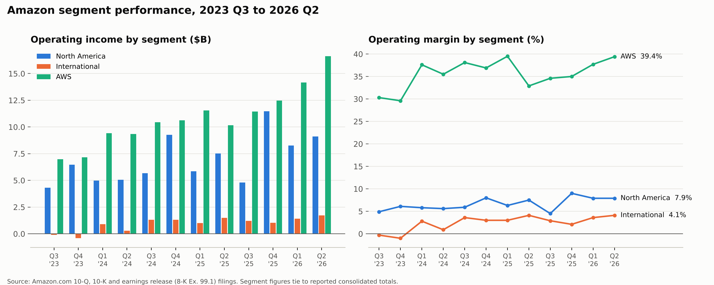
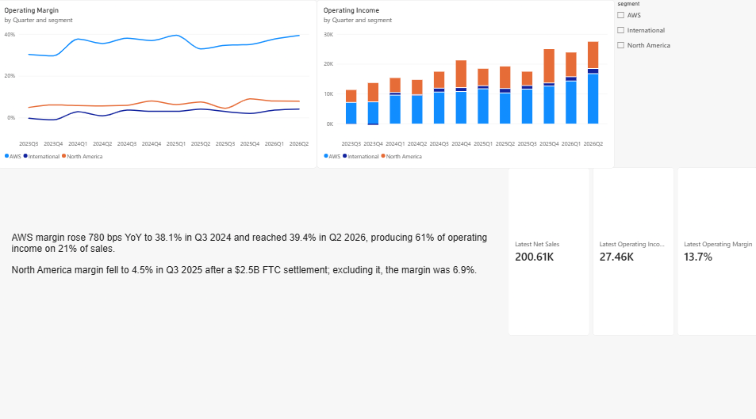

# Amazon Segment Variance Analysis

A close-style quarterly variance report on Amazon's three operating segments (North America, International, AWS), built from Amazon's own SEC filings. Twelve quarters, Q3 2023 to Q2 2026.



## Key findings (Q2 2026)

## Power BI dashboard



`amazon_segments.pbix` and `measures.dax`. A Calendar table drives a year-over-year margin measure (SAMEPERIODLASTYEAR), which returns blank when either quarter is missing so it never shows a false change at the edges of the data. Card totals reconciled to `segment_report.xlsx`.

| Segment | Net sales | Op. income | Margin | Sales YoY | Share of OI |
|---|---|---|---|---|---|
| North America | $116.2B | $9.1B | 7.9% | +16.1% | 33% |
| International | $42.2B | $1.7B | 4.1% | +14.8% | 6% |
| AWS | $42.2B | $16.6B | 39.4% | +36.8% | 61% |

**Variance commentary**

1. **AWS, Q3 2024 (+780 bps YoY to 38.1%).** Margin step-up came from sales growth, lower payroll costs, and lower depreciation after Amazon extended the estimated useful life of its servers in 2024.
2. **International, 2024 turnaround.** Operating income went from a $419M loss in Q4 2023 to $1.3B profit in Q4 2024, as higher unit and advertising sales outgrew shipping and fulfillment cost increases.
3. **North America, Q3 2025 (OI down $874M YoY).** A $2.5B FTC legal settlement plus part of $1.8B in company-wide severance. Excluding the FTC charge, segment margin was 6.9%, not 4.5%.
4. **AWS, Q2 2026 (OI +64% YoY).** Sales grew 37%, the fastest in 18 quarters, outpacing infrastructure spend. AWS produced 61% of operating income on 21% of sales.

## How it works

```
segments.csv             one row per segment per quarter, with source filing
consolidated_check.csv   reported company totals, used for tie-out
crosscheck_sources.csv   each figure as printed in a second SEC filing
commentary.csv           variance commentary with source and fact-check flag
01_schema.sql            tables
02_views.sql             tie-out, QoQ/YoY growth, margins, OI share, ranked swings
refresh.py               rebuilds the database, runs both checks, writes Excel and chart
```

**Data integrity checks.** Before producing any output, the script runs two checks and stops if either fails:

1. **Tie-out:** the three segments sum exactly to Amazon's reported consolidated net sales and operating income for every quarter.
2. **Second source:** every figure matches the same quarter as printed in a different SEC filing (`crosscheck_sources.csv`), usually that quarter's original earnings release.

## Adding a new quarter

1. Add three rows to `segments.csv` and one row to `consolidated_check.csv` from the new 10-Q, plus three rows to `crosscheck_sources.csv` from a second filing (the earnings release works).
2. Run `python refresh.py`.

Output: `segment_report.xlsx` (summary, commentary, biggest swings, full analysis, tie-out, raw data) and `segment_chart.png`.

Requirements: Python 3.9+, `pandas`, `openpyxl`, `matplotlib`. SQLite ships with Python.

## Sources

- [Q4 2024 earnings release (8-K Ex. 99.1)](https://www.sec.gov/Archives/edgar/data/1018724/000101872425000002/amzn-20241231xex991.htm): Q3 2023 to Q4 2024
- [Q2 2026 earnings release (8-K Ex. 99.1)](https://www.sec.gov/Archives/edgar/data/1018724/000101872426000024/amzn-20260630xex991.htm): Q1 2025 to Q2 2026
- [Q1 2024 10-Q](https://www.sec.gov/Archives/edgar/data/1018724/000101872424000083/amzn-20240331.htm), [Q2 2024 10-Q](https://www.sec.gov/Archives/edgar/data/1018724/000101872424000130/amzn-20240630.htm), [Q3 2024 10-Q](https://www.sec.gov/Archives/edgar/data/1018724/000101872424000161/amzn-20240930.htm), [Q3 2025 10-Q](https://www.sec.gov/Archives/edgar/data/1018724/000101872425000123/amzn-20250930.htm), [Q2 2026 10-Q](https://www.sec.gov/Archives/edgar/data/0001018724/000101872426000026/amzn-20260630.htm): MD&A for variance commentary

Figures were extracted from SEC filings with Claude, then every number was checked against a second filing where available and tied out to Amazon’s reported totals before use.
